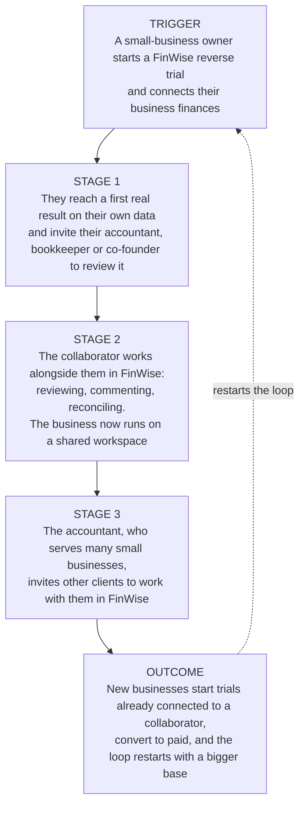

# The Bet · FinWise

> Module 1 · Ignite a PLG Motion. The growth hypothesis and where you're betting, plus the growth-loop visualization.

## Growth hypothesis

_The core belief: if we do X, then Y, because Z._

FinWise's biggest growth problem is **turning trial users into paying customers (the Revenue stage): trial-to-paid conversion is stuck at ~2% every month, whatever happens to traffic or feature usage**, because **trial users never reach a specific moment of real value during the premium period, so the reverse trial's loss aversion has nothing to work on.**

_Working notes: 

The problem isn't getting users in the door, it's what happens after they arrive. A reverse trial runs on loss aversion, and users can only feel the loss of value they've actually experienced; if they never reach the Aha moment during premium, the downgrade costs them nothing. 

Evidence: (1) only 2% of trial starts convert to paid, so 98 of every 100 sign-ups FinWise pays to acquire never pay; (2) most of the marketing budget goes to paid acquisition, yet adding more money is no longer driving meaningful growth, so the top of the funnel isn't the binding constraint; (3) one-year retention for paid customers is 40% (60% churn), so even users who pay don't stay, consistent with value not being established early. 

Against the data: **Confirmed, and refined.** 

Over 13 months (Oct 2023 – Oct 2024), the single biggest drop-off is Trial Started → Paid: 6,296 of 6,424 trials (98.0%) never converted. That is the Revenue stage, where users decide to pay. Trial-to-paid held between 1.87% and 2.08% in every month, and paid conversions tracked trials almost exactly (r = 0.99). Traffic is not the lever: monthly visits and trials are uncorrelated (r = 0.09). 

The refinement: adoption of the Modeling feature rose from 10.78% to 58% over the period with no change in conversion (r = 0.25, not significant), so broader feature usage alone doesn't create the paying moment. The bet has to lead users to one specific value moment, not just more usage. The 2% → 3% target lies above anything observed in 13 months, so it is deliberately ambitious._

_____

## The bet

_Where you focus, and what you're deliberately NOT doing._

My first experiment would be **a guided first-session onboarding for every new trial user that walks them to their first core value action on their own business data**, because it attacks the constraint directly: the 98% of trial users who leave without paying, not the paid channels that are already saturated.

| | |
|---|---|
| **IF** | we guide every new trial user through a short first-session setup that ends with a real result on their own business data |
| **THEN** | trial-to-paid conversion WILL increase from 2% to 3% |
| **BECAUSE** | most trial users never experience FinWise's premium value before the trial ends, so the reverse trial's loss aversion has nothing to work on |
| **MEASURED WITH** | an A/B test on new trial sign-ups over one full reverse-trial cycle; trial-to-paid conversion as the primary metric, week-1 core-action completion as the leading indicator, day-1 drop-off as the guardrail |

**Not doing:** I'm not going after more paid acquisition or the visit-to-trial step, because traffic doesn't predict trials (r = 0.09) and the steepest loss happens after the trial starts. I'm also not tackling churn first, even though more customers churned than converted in every one of the 13 months: a user has to pay before they can be retained, and splitting focus there would pull effort from the bet above.

_____

## Growth loop

_A link or image of the loop that compounds (acquisition → activation → retention → referral)._

**Loop type:** Collaboration, because a small business's finances are rarely managed alone. Bringing an accountant, bookkeeper or co-founder into FinWise during the trial deepens the value the owner experiences (supporting conversion) and creates shared dependency (supporting retention). Each accountant who serves several small businesses then becomes a channel to new trials. A content-driven loop would mainly add top-of-funnel traffic, which the data shows is not the constraint.

_Assumptions to validate: that FinWise supports multi-user collaboration on a shared workspace, and that small-business customers commonly work with an external accountant or bookkeeper. Neither is measured in the current dataset, which has no invite, referral or seat data._

_____

